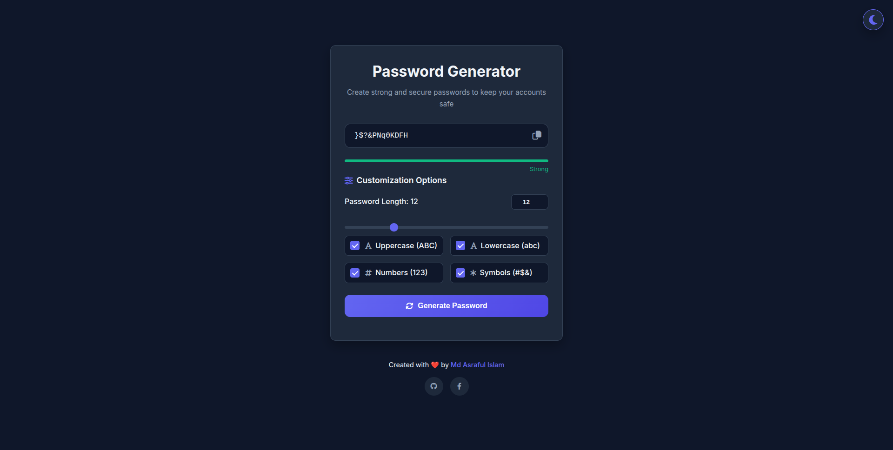
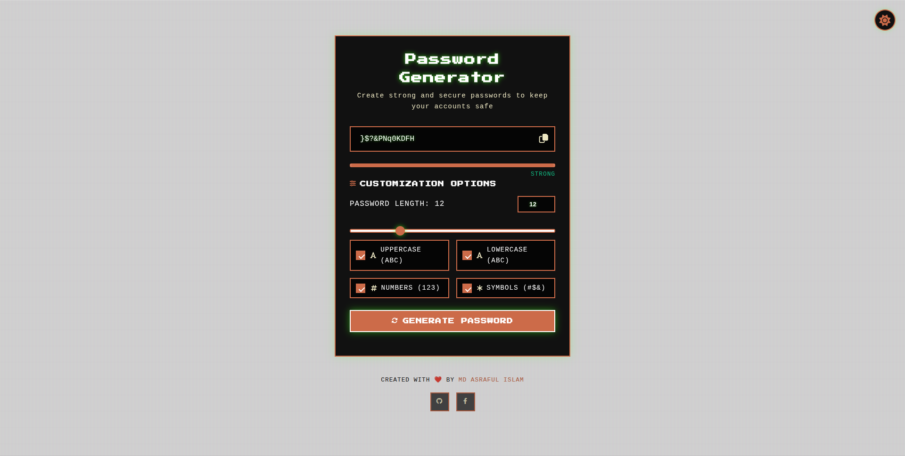

# Retro Password Generator

A powerful, retro-themed password generator that creates strong, secure passwords with customizable options. Features both modern and retro CRT monitor themes for a unique user experience.

## Features

- **Strong Password Generation**: Create secure passwords with customizable length (6-32 characters)
- **Character Options**: Include/exclude uppercase letters, lowercase letters, numbers, and symbols
- **Password Strength Indicator**: Visual meter showing password strength
- **Password History**: Stores last 5 generated passwords for easy access
- **Theme Switching**: Toggle between modern UI and retro CRT monitor theme
- **One-Click Copy**: Copy passwords to clipboard with a single click
- **Responsive Design**: Works seamlessly on desktop and mobile devices
- **Accessibility**: ARIA labels and keyboard navigation support

## Screenshots


_Modern Theme Interface_


_Retro CRT Theme Interface_

## Installation

1. Clone the repository:

```bash
git clone https://github.com/search4asraful/passwordGenerator.git
```

2. Navigate to the project directory:

```bash
cd passwordGenerator
```

3. Open `index.html` in your web browser:

```bash
open index.html
```

## Usage

1. **Generate a Password**:

   - Adjust the password length using the slider or input field
   - Select which character types to include (uppercase, lowercase, numbers, symbols)
   - Click "Generate Password" to create a new password

2. **Copy Password**:

   - Click the copy icon next to the generated password
   - A notification will appear when copied successfully

3. **View Password History**:

   - Previously generated passwords appear in the history section
   - Click any password in the history to copy it

4. **Switch Themes**:

   - Click the theme toggle button in the top-right corner
   - Switch between modern and retro CRT themes

5. **Clear History**:
   - Click the "Clear" button in the password history section to remove all saved passwords

## Technologies Used

- **HTML5**: Semantic markup for accessibility and SEO
- **CSS3**: Modern styling with animations and transitions
- **JavaScript (ES6+)**: Interactive functionality and password generation
- **Google Fonts**: Inter and Press Start 2P for typography
- **Font Awesome**: Icon library for UI elements
- **LocalStorage**: Browser-based storage for password history and theme preferences

## Browser Compatibility

This project is compatible with all modern browsers:

- Chrome (latest 2 versions)
- Firefox (latest 2 versions)
- Safari (latest 2 versions)
- Edge (latest 2 versions)

## Contributing

Contributions are welcome! Please follow these steps:

1. Fork the repository
2. Create a new branch (`git checkout -b feature/amazing-feature`)
3. Commit your changes (`git commit -m 'Add some amazing feature'`)
4. Push to the branch (`git push origin feature/amazing-feature`)
5. Open a Pull Request

### Development Guidelines

- Follow the existing code style
- Ensure accessibility standards are met
- Test your changes in multiple browsers
- Update documentation as needed

## License

This project is licensed under the MIT License - see the [LICENSE](LICENSE) file for details.

## Acknowledgments

- Created by [Md Asraful Islam](https://www.facebook.com/search4asraful)
- Inspired by retro computer terminals and modern security practices
- Icons provided by [Font Awesome](https://fontawesome.com/)
- Fonts from [Google Fonts](https://fonts.google.com/)

## SEO Optimization

This project includes comprehensive SEO optimizations:

- Semantic HTML5 structure
- Meta tags for search engines and social sharing
- Structured data (JSON-LD) for better search engine understanding
- Open Graph and Twitter Card tags for social sharing
- Proper heading hierarchy and internal linking
- Mobile-friendly responsive design

## Future Enhancements

- Password strength analysis with detailed feedback
- Option to save passwords with labels
- Dark/light mode variations for the modern theme
- Password expiration reminders
- Browser extension for easy access
- Additional retro themes (Windows 95, Mac OS 9, etc.)

---

If you find this project useful, please consider giving it a ⭐️ on GitHub!
